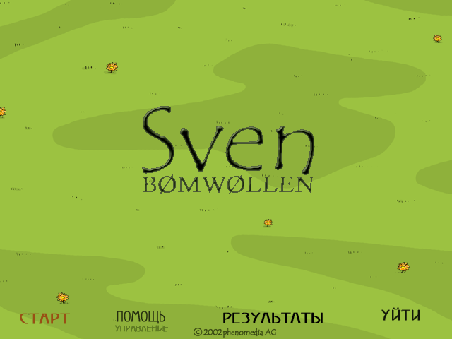
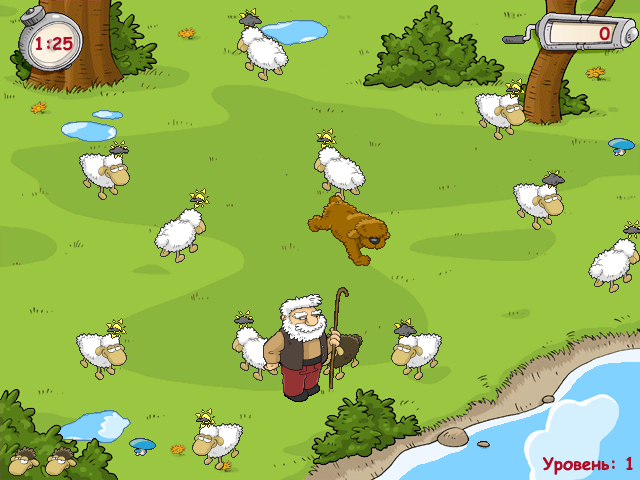
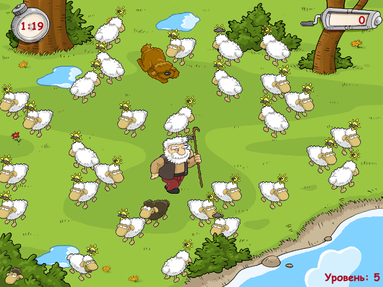

# Sven Bømwøllen — JavaScript port

A faithful browser port of *Sven Bømwøllen* (phenomedia AG, 2002): Sven the black ram
chases the sheep while the shepherd and his dog try to stop him. The title is written with **ø**, the
Danish/Norwegian letter, as on the original title screen (ASCII spelling: *Sven Bomwollen*).

The port follows the original executable's behaviour as closely as possible (timing,
movement, AI, scoring, screens, sounds), checked against a decompile of the game. This
copy is the Russian release (menus and texts in Russian).



| Level 1 | Level 5 |
|---|---|
|  |  |

## Usage

```
npm install
npm start          # dev server at http://localhost:8088/ (no caching)
npm run build      # build into dist/ (index.html, one minified game.js, assets/)
npm run serve:dist # serve dist/ at http://localhost:8088/
npm test           # regression suite (Playwright; needs the dev server running)
```

The game needs a web server (opening `index.html` from disk cannot load the INI and
sound files). `dist/` is static and can be hosted anywhere.

Controls: arrow keys (rebindable in the help screen), Enter to start, Esc for the menu.
Add `?debug` to the URL for debug keys (N/P/R level, L life, T clock, G grid, H panel).

## Layout

- `index.html` — page and script load order
- `src/` — game sources (plain `<script>` globals, no modules)
- `assets/` — sounds and INI data unpacked from the original `Sven.dat`; sprites as PNG
  with the colour key baked into alpha (`assets/raw/`: three unkeyed bitmaps the UFO shadow reads)
- `scripts/` — dev server and build
- `tests/` — Playwright regression suite
- `docs/` — screenshots
